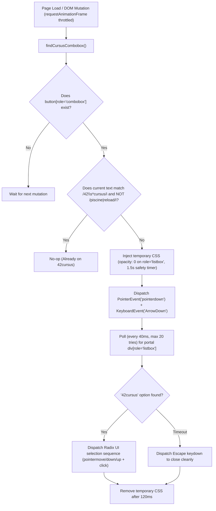

# 42 Intra — Force `42cursus` Header

> 🌐 **Language / Idioma:** **English (Primary)** | [🇪🇸 Español (README.es.md)](./README.es.md)

Lightweight browser extension (WebExtension Manifest V3), Userscript, and cross-platform user-space auto-installer (Linux & Windows) designed to automatically force the header cursus selector on the 42 Intra v3 dashboard (`profile.intra.42.fr` / `profile-v3.intra.42.fr`) to display **`42cursus`** (e.g., `Cadet at 42cursus`) by default instead of *C Piscine* or *Piscine Reloaded*.

---

## Quick Start

### On Linux (42 Cluster or Personal PC — No `sudo` required)
```bash
git clone https://github.com/BernatQI/force-cursus-header.git
cd force-cursus-header
./install.sh
```
*(To uninstall at any time: `./uninstall.sh`)*

### On Windows (Double-click, PowerShell, or Git Bash — No Administrator required)
1. Clone or download the repository:
   ```powershell
   git clone https://github.com/BernatQI/force-cursus-header.git
   cd force-cursus-header
   ```
2. **Fastest option:** **Double-click `install.bat`** in Windows Explorer, or run in PowerShell / CMD:
   ```powershell
   .\install.bat
   ```
   *(You can also run `./install.sh` from **Git Bash** or **WSL**; the script automatically detects Windows and delegates to `install.ps1`).*
3. *(To uninstall on Windows: double-click `uninstall.bat` or run `.\uninstall.bat`).*

---

## Technical Architecture & How It Works

### 1. The Problem in 42 Intra v3
The 42 Intra v3 profile frontend is built with **React (Next.js)**, **Tailwind CSS**, and accessible primitives from **Radix UI** (`@radix-ui/react-select`).
On initial page load, the cursus selector component frequently hydrates with the user's earliest historical cursus or temporary event (*C Piscine* or *Piscine Reloaded*) rather than the main curriculum (`42cursus`, `cursus_id = 21`).

In the DOM, the selector renders as:
```html
<button
  type="button"
  role="combobox"
  aria-controls="radix-:r8:"
  aria-expanded="false"
  data-state="closed"
>
  <span style="pointer-events: none;">Cadet at 42cursus</span>
</button>
<a href="https://profile.intra.42.fr/users/<login>/experiences/cursus_id/21">...</a>
```

### 2. Why Standard `.click()` Does Not Work
**Radix UI** `<Select.Trigger>` and `<Select.Item>` primitives ignore synthetic `element.click()` events for opening menus:
- `<Select.Trigger>` listens to **`pointerdown`** events (`event.button === 0 && event.ctrlKey === false`) or keyboard events (`ArrowDown`, `Enter`, `Space`) to transition its internal state to `open` and mount a `<Select.Portal>` into `<body>`.
- Once mounted, the portal renders `<div role="listbox" id="radix-:r8:">` containing `<div role="option">` items.
- Each `<Select.Item>` requires the synthetic sequence `pointermove` → `pointerdown` → `pointerup` → `click` / `Enter` to trigger React's `onValueChange` callback and update the entire dashboard (level, percentage, coalition, projects, and *Holy Graph*).

### 3. Execution Flow (`content.js` / `.user.js`)



### 4. Security, Privacy & Stability Guarantees
- **Zero Browser Permissions:** `extension/manifest.json` requests **no** `permissions` and **no** `host_permissions`. Content script execution is strictly scoped to `https://profile.intra.42.fr/*` and `https://profile-v3.intra.42.fr/*`.
- **Zero Network Calls / Zero Telemetry:** 100% local DOM inspection. No `fetch`, `XMLHttpRequest`, or external connections.
- **Bounded Execution (Zero Infinite Loops):** `MutationObserver` is throttled via `requestAnimationFrame` and capped at `MAX_SWITCH_ATTEMPTS = 2` per URL pathname (so profiles that only have *C Piscine* never loop).
- **Respects Manual User Selection:** Captures `pointerdown` with `event.isTrusted === true` so if you manually open the selector to check your *Piscine* or *Reloaded* history, the script stops auto-switching for that view.
- **Non-Intrusive OS Installer:** By default, `install.sh` and `install.ps1` do **not** modify global browser shortcuts (`.desktop` or `.lnk`) unless explicitly requested via `--patch-shortcuts` / `-PatchShortcuts`.

---

## Repository Structure

```text
force-cursus-header/
├── extension/
│   ├── manifest.json                     # WebExtension Manifest V3 configuration (Chrome/Brave/Edge/Firefox)
│   └── content.js                        # Content script injected into profile.intra.42.fr
├── userscript/
│   └── force-42cursus-header.user.js     # Userscript for Tampermonkey / Violentmonkey
├── docs/
│   ├── PROJECT_ROADMAP.md                # Project milestones and status (English)
│   ├── adr/                              # Architecture Decision Records (English + /es Spanish mirrors)
│   └── specs/                            # Spec-Driven Development specifications (English + /es mirrors)
├── .github/agents/                       # Specialized AI Agent role definitions
├── .agents/                              # Autonomous execution guardrails and task-scoper skill
├── install.sh                            # Linux & Git Bash/WSL auto-installer
├── install.ps1                           # Windows native PowerShell auto-installer (main-thread safe)
├── install.bat                           # Windows double-click launcher
├── uninstall.sh                          # Linux & Git Bash/WSL uninstaller
├── uninstall.ps1                         # Windows native PowerShell uninstaller
├── uninstall.bat                         # Windows double-click uninstaller
├── Makefile                              # Validation harness (make harness-check) & worktree automation
├── AGENTS.md                             # Orchestrator & SDD directives
├── TASK_CONTRACT.md                      # Active autonomous execution contract
├── README.md                             # Primary technical documentation (English)
└── README.es.md                          # Secondary technical documentation (Spanish)
```

---

## Manual Installation Step-by-Step

If you prefer manual installation without running `./install.sh` or `install.bat`, choose **one** of the following methods:

### Method 1: Native Browser Extension (Chrome / Brave / Chromium / Edge)
1. Open `chrome://extensions/` in your browser.
2. Enable **Developer mode** (top-right toggle).
3. Click **Load unpacked** (top-left button).
4. Select the `extension/` folder from this repository (or `%LOCALAPPDATA%\force-cursus-header\extension` on Windows / `~/.local/share/force-cursus-header/extension` on Linux if you ran the installer, which already copied this path to your clipboard).

### Method 2: Userscript via Violentmonkey / Tampermonkey (All Browsers)
1. Install [Violentmonkey](https://violentmonkey.github.io/) or [Tampermonkey](https://www.tampermonkey.net/).
2. Open the extension dashboard and click **`+`** (*Create a new script*).
3. Paste the contents of [`userscript/force-42cursus-header.user.js`](./userscript/force-42cursus-header.user.js) and save (`Ctrl + S`).

### Method 3: Mozilla Firefox Extension
1. Open `about:debugging#/runtime/this-firefox`.
2. Click **Load Temporary Add-on...**.
3. Select [`extension/manifest.json`](./extension/manifest.json).

---

## Validation Harness (Developers & AI Agents)

Run the automated validation harness before committing changes:
```bash
make harness-check
```
This verifies JSON validity, Bash syntax (`bash -n`), JavaScript syntax (`node --check`), least-privilege manifest rules, and ensures zero personal paths or logins exist in the codebase.
